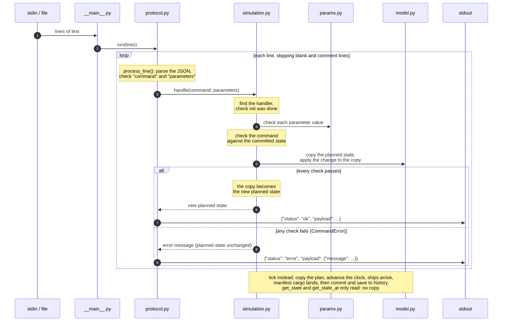

# Fleet Simulation Engine: Design

**Author:** Andy Chan \
**Date:** November 2, 2026

## Introduction

This project is a discrete-time simulation engine for a fleet of vessels.

- Vessels can travel between ports.
- A tick is the basic time unit.
- Ports and vessels can carry cargo. Each unit of cargo is identified by its destination port.

Please consult the project document for the detailed operations. This document focuses on discussing design decisions, implementation, test coverage, time and space complexity, future enhancements, and AI usage.

## Design Decisions

### Questions Left to the Implementer

| ID | Question | Decision | Rationale |
|---|---|---|---|
| D1 | `set_destination` to the current port | Accepted; the vessel stays idle. | This provides a way to cancel a pending `set_destination` command. |
| D2 | `dock` after `dock` | Accepted; nothing changes. | This matches the spec better. |
| D3 | `undock` after `dock` | Accepted; cancels the pending dock. | This provides a way to cancel a pending `dock`. |
| D4 | `undock` after `undock` | Accepted; nothing changes. | This matches the spec better. |
| D5 | `dock` after `undock` | Accepted; cancels the pending undock. | This provides a way to cancel a pending `undock`. |
| D6 | `undock` after `load`/`unload`/`swap` | Accepted; the cargo moves and the vessel undocks in the same tick. | Commands are executed in order, so cargo operations are allowed before undocking. |
| D7 | `load`/`unload`/`swap` after `undock` | Rejected. | Commands are executed in order, so cargo operations are not allowed after undocking until a `dock` cancels the `undock`. |
| D8 | `load` and `unload` the same cargo | Accepted; the operations cancel out and throughput only counts each vessel's net change. | Net change counts only the necessary work. |

### Other Questions That Came Up During Implementation

| ID | Question | Decision | Rationale |
|---|---|---|---|
| D9 | Loading cargo that another vessel unloaded in the same tick | Accepted. | Commands are executed in order, so a cargo unit just unloaded by a vessel can be loaded by another vessel in the same tick. |
| D10 | `swap` if only one half can succeed | Rejected; nothing changes. | A half-done swap isn't what the user asked for. |
| D11 | `swap` of cargo to the same destination | Accepted; always counts as a no-op. | Swapping a destination for itself can't change anything, so a no-op is the simplest rule for users. |

## Implementation

- `__main__.py`: Entry point that reads from stdin or a file.
- `protocol.py`: Goes from JSON to Python dictionaries and vice versa. Any failure becomes an error response.
- `simulation.py`: Core engine that holds the state and runs each command against it.
- `params.py`: Command parameter checker.
- `model.py`: World, Vessel, and cargo counts.

One command's path through the code:

Some implementation details:

- Implemented in Python, standard library only, and tested with Python 3.9-3.14.
- On every command that changes state, the planned state is copied and modifications are made on the copy. If the command is successful, the copy replaces the planned state. This approach is simple and easy to trust, but less efficient.
- Instead of keeping a running counter, dock throughput is calculated by comparing each docked vessel's cargo with its last committed state. This makes cancel-outs automatic.
- History keeps a full snapshot per tick, so memory grows with ticks x (vessels + cargo entries).

## Test Coverage

The tests below achieve 100% line and branch coverage. Mutation testing, in particular, plants 437 bugs and catches 434 of them. The three uncaught "bugs" were checked manually to verify that they don't actually alter the program.

Every pull request and push triggers GitHub Actions, which runs the unit tests on both Linux and macOS for Python 3.9-3.14.

### Run by `python -m unittest`

| ID | Category | Location | Coverage |
|---|---|---|---|
| T1 | Project examples | [`tests/transcripts/spec/`](tests/transcripts/spec/) | Examples in the project document |
| T2 | Design decisions | [`tests/transcripts/decisions/`](tests/transcripts/decisions/) | One test per design decision |
| T3 | Rules and edge cases | [`tests/transcripts/rules/`](tests/transcripts/rules/) | Rules and edge cases such as shared dock throughput, simultaneous arrivals, empty fleet, single port, large values, unusual vessel IDs |
| T4 | Command matrix | [`tests/test_command_matrix.py`](tests/test_command_matrix.py) | All 56 combinations of 8 vessel situations × 7 movement and cargo commands |
| T5 | Random stress test | [`tests/test_invariants.py`](tests/test_invariants.py) | About 20,000 random commands on small worlds, with rules checked after every command |
| T6 | Command line | [`tests/test_cli.py`](tests/test_cli.py) | Messy inputs, various output behaviors, and startup errors |
| T7 | Output order | [`tests/test_output_order.py`](tests/test_output_order.py) | Vessels are listed in `init` order |
| T8 | Unexpected error response | [`tests/test_protocol.py`](tests/test_protocol.py) | Correct handling of an unexpected internal bug |
| T9 | Tools | [`tests/test_tools.py`](tests/test_tools.py) | Verification of the demo, viewer tool, mutation tool, and benchmark tool |

### Run on Request

| ID | Category | Location | Coverage |
|---|---|---|---|
| T10 | Large world | [`tests/test_large_world.py`](tests/test_large_world.py) | 100 ports, 1,000 vessels, and about 4,000 commands, with rules checked after every command |
| T11 | Mutation | [`tools/mutation_test.py`](tools/mutation_test.py) | Planting bugs and checking that the tests successfully catch every one that can change program behavior |
| T12 | Benchmark | [`tools/benchmark.py`](tools/benchmark.py) | Speed per command and memory growth |

## Performance

The time complexity is O(n) per command, where n is the size of the world state (i.e., vessels + cargo entries).

The space complexity is O(t x n), where t is the number of ticks and n is the size of the world state.

In a test with 100 ports, 1,000 vessels, and a few thousand cargo entries, it takes around 15 ms per tick and 8 ms per command that changes state. Memory grows by about 700 KB per tick.

## Future Enhancements

Some possible future enhancements:

- Instead of doing a deep copy of the entire world state when handling a command that changes state, we can copy only the vessel and dock a command touches.
- Instead of storing the entire world state for each tick, we can store only what changed each tick.
- Other features that make the simulation more realistic such as per-vessel cargo capacity limit, per-vessel travel speed, per-dock vessel limit.

## AI Usage

Claude was used to write the code, tests, tools, README, and presentation. This design document was written manually, with AI used only for grammar, image generation, and research.
